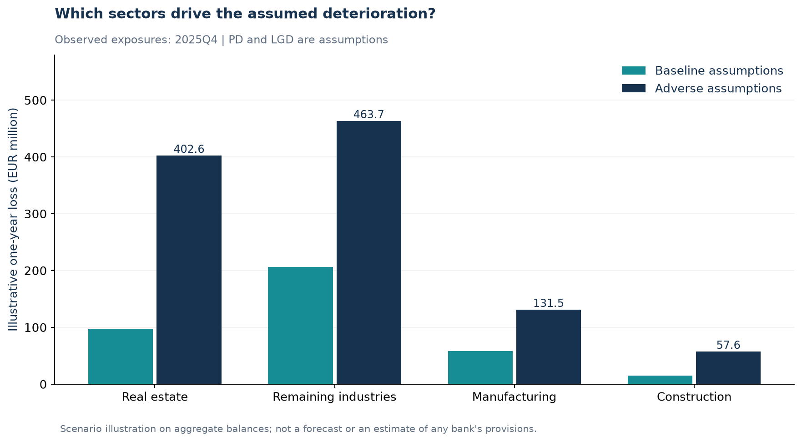

# Finnish credit-risk scenarios

Explore how observed corporate lending exposures and explicit credit assumptions combine into an illustrative one-year loss scenario.

**[Open the interactive demo →](https://goudarzimostafa.github.io/finland-credit-risk-scenarios/)**

Adjust baseline default probability, loss given default and recession severity. The demo recalculates portfolio losses and industry contributions in your browser. Reset returns to the documented reference assumptions.



## What this demonstrates

- Reproducible ingestion of official public data, with saved requests, metadata and integrity hashes.
- A small Python calculation engine with input validation, aggregation and sensitivity analysis.
- A clear separation between **observed exposures**, **assumed credit parameters** and **calculated outcomes**.
- An executed [notebook](notebooks/analysis.ipynb), interactive browser demo and automated checks.

## Data and assumptions

Bank of Finland loan stocks at **31 December 2025** cover domestic non-financial corporations excluding housing corporations, reported by MFIs excluding Bank of Finland. All currencies are expressed in euros. Manufacturing, construction and real estate are observed groups; remaining industries are the residual needed to reconcile to the published total of **EUR 62.916 billion**.

Statistics Finland bankruptcy counts for **2020Q1–2025Q4** provide economic context. They are not borrower default rates and are not used to estimate PD.

For each industry:

```text
Illustrative loss = outstanding loan balance × PD × LGD
Stressed PD       = min(1, baseline PD × adverse multiplier)
Stressed LGD      = min(1, baseline LGD + adverse uplift)
```

The reference scenario starts at an assumed **1.5% one-year PD** and **40% LGD** in every industry. Industry-specific adverse multipliers and LGD increases are disclosed in [config/scenarios.json](config/scenarios.json).

| Reference calculation | EUR million |
|---|---:|
| Baseline loss proxy | 377.5 |
| Adverse loss proxy | 1,055.4 |
| Increase | 677.9 |

Real estate accounts for 45.0% of the increase under these assumptions. That ranking reflects exposure weights and chosen stress parameters.

In the demo, severity `s` scales each configured PD multiplier `m` to `1 + s × (m − 1)` and each LGD uplift `u` to `s × u`. Severity 0 removes the adverse shock; severity 1 reproduces the reference scenario. This slider is a teaching convention, not an estimated macroeconomic relationship.

## Run locally

Python 3.13 is the tested environment. The Python package requires 3.11 or newer; the exact dependency snapshot was recorded on macOS with Python 3.13.

```bash
python3 -m venv .venv
source .venv/bin/activate
python -m pip install -r requirements-lock.txt
python -m pip install --no-deps -e .
python scripts/build.py
```

The build runs the tests, regenerates figures and numerical exports, and executes the notebook in a fresh kernel. Saved data are used offline; live refresh is a separate, explicit step described in the source notes.

To use compatible dependency ranges instead of the recorded environment:

```bash
python -m pip install -e ".[notebook]"
```

To run the browser demo locally:

```bash
python -m http.server 8000 --directory site/dist
```

Open `http://localhost:8000`. The demo has no backend, account requirement or external JavaScript dependencies. GitHub Pages deploys the files in site/dist automatically when they change on main.

## Project structure

```text
config/                    Disclosed scenario assumptions
data/raw/                  Official snapshots, queries and provenance
data/processed/            Reconciled exposure and bankruptcy data
docs/SOURCES_*.md           Data definitions, transformations and attribution
notebooks/analysis.ipynb    Executed analysis
src/credit_scenarios/       Ingestion, model and reporting modules
tests/                     Arithmetic, validation and source checks
scripts/build.py           Offline analysis build
site/dist/                 Interactive demo source
outputs/                   Reference figures and numerical results
```

Run Python checks with `python -m unittest discover -s tests -v`. The test suite checks calculations, invalid inputs, zero-loss cases, monotonicity, caps, source parsing and reconciliation. Recorded input/code hashes are in [outputs/run_manifest.json](outputs/run_manifest.json).

## Interpretation and limits

Outstanding loan balances are fixed **EAD proxies**. Existing non-performing balances are retained and are not separately modelled. This is therefore a scenario loss proxy on total loan stocks, not a forecast of new losses on a performing-loan portfolio.

PD, LGD, recovery deterioration and the severity mapping are assumptions. The sensitivity grid gives conditional outcomes, not confidence intervals. The heterogeneous remaining-industries bucket and public aggregates cannot identify individual borrower risk, collateral, recovery timing or default dependence.

This learning project does not represent Nordea's portfolio, IFRS 9 provisions, regulatory capital or tail losses.

## Sources and licence

- **Source: Bank of Finland.** [Lending definitions and API selection](docs/SOURCES_LENDING.md).
- **Source: Statistics Finland.** [Bankruptcy definitions and query](docs/SOURCES_MACRO.md).

Source data retain their **CC BY 4.0** licences. Currency conversion, quarterly aggregation, residual groups and scenario calculations are project transformations. Code is provided under the [MIT licence](LICENSE).
